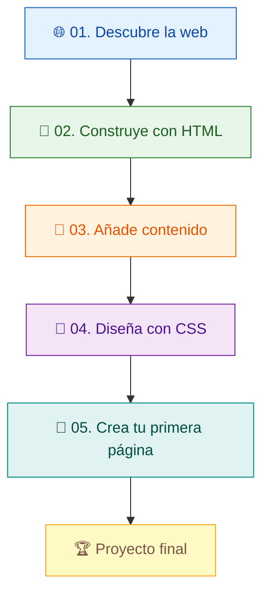

 <a id="inicio"></a>

<div align="center">


# 🌐 Tu primera página web

### De una idea a una página con HTML y CSS

**Aprende · Experimenta · Crea**


**Tu navegador es tu laboratorio. Tu creatividad es el límite.**

[🚀 Comenzar](#primeros-pasos) · [📚 Lecciones](#lecciones) · [🎯 Proyecto final](#proyecto) · [📁 Repositorio](#estructura)

</div>

---

## 👋 Bienvenido al curso

¿Alguna vez te has preguntado cómo se construyen las páginas web que visitas todos los días?

En este curso aprenderás a crear tu primera página web desde cero utilizando **HTML y CSS**. No necesitas experiencia previa: comenzarás con conceptos sencillos y avanzarás progresivamente hasta construir un perfil web personalizado.

El curso está diseñado para estudiantes de secundaria de **12 a 17 años** que desean descubrir el desarrollo web mediante explicaciones, demostraciones y ejercicios prácticos.

<details>
<summary><strong>📌 Información general del curso</strong></summary>

| Detalle | Información |
|---|---|
| Universidad | Universidad Peruana de Ciencias Aplicadas (UPC) |
| Carrera | Ingeniería de Software |
| Curso | 1ASI0730 — Aplicaciones Web |
| NRC | 16127 |
| Período académico | 202620 |
| Organización | AGROFLET |
| Repositorio | webdev-course-nexaweb |
| Nivel | Principiante |
| Público objetivo | Estudiantes de 12 a 17 años |
| Tecnologías | HTML5 y CSS3 |
| Plataforma de prácticas | CodePen |
| Lecciones | 5 |
| Duración acumulada de videos | 61 min 09 s |
| Modalidad | 100 % online |

</details>

> [!IMPORTANT]
> **Plataforma oficial:** todas las demostraciones y prácticas del curso se realizarán en CodePen. Los enlaces a proyectos de práctica precargados se incorporarán cuando estén disponibles.

## 🗺️ Ruta de aprendizaje

Cinco lecciones para pasar de no conocer HTML y CSS a construir una página web propia.



### 🎓 ¿Qué aprenderás?

Al finalizar el curso podrás:

- Diferenciar HTML, que estructura el contenido, de CSS, que define su presentación visual.
- Reconocer etiquetas, elementos, atributos y la estructura básica de un documento HTML.
- Organizar información utilizando encabezados, párrafos y secciones.
- Incorporar listas, imágenes accesibles y enlaces.
- Aplicar colores, tipografías, márgenes, rellenos y bordes con CSS.
- Personalizar una página y solucionar errores básicos mediante la vista previa.

---

<a id="primeros-pasos"></a>

## 🚀 Primeros pasos

¡No necesitas instalar programas para comenzar!

Solo necesitas:

- 💻 Una computadora o dispositivo con navegador.
- 🌐 Conexión a Internet.
- ✨ Curiosidad y ganas de aprender.

### 🖥️ Nuestra plataforma: CodePen

<div align="center">

<a href="https://codepen.io/pen/">
  
</a>

**[Ingresar al editor de CodePen](https://codepen.io/pen/)**

</div>

Utilizaremos CodePen como nuestro entorno de aprendizaje para escribir código, experimentar con estilos y visualizar los resultados directamente desde el navegador.

### ¿Cómo realizar las prácticas?

1. Ingresa a [CodePen](https://codepen.io/pen/).
2. Abre un nuevo Pen para trabajar en el editor.
3. Localiza los paneles **HTML**, **CSS** y **JS**.
4. Copia el contenido de `html.txt` en el panel HTML.
5. Copia el contenido de `css.txt` en el panel CSS.
6. Deja el panel JS vacío, ya que este curso trabaja únicamente con HTML y CSS.
7. Observa el resultado en la vista previa y modifica el código para experimentar.

<details>
<summary><strong>💡 ¿Qué debes colocar en cada panel?</strong></summary>

| Panel de CodePen | Archivo del repositorio | Función |
|---|---|---|
| HTML | `html.txt` | Estructura y contenido de la página. |
| CSS | `css.txt` | Colores, tipografías, espacios y diseño. |
| JS | No se utiliza | No necesitamos JavaScript en este curso. |

**Importante:** el panel HTML de CodePen permite escribir el contenido que irá dentro del cuerpo de la página. Por eso, pega el fragmento HTML de la práctica, no un documento completo con `DOCTYPE`, `html`, `head` y `body`.

El CSS se coloca directamente en el panel CSS. CodePen se encarga de mostrar los cambios en la vista previa.

</details>

### 🔄 Nuestro método de práctica

```text
       📂 STARTER-FILES
       Código inicial
             |
             v
       🖥️ CODEPEN
    Escribir HTML y CSS
             |
             v
       👀 VISTA PREVIA
     Observar el resultado
             |
             v
       ✏️ EXPERIMENTAR
     Modificar y practicar
             |
             v
    ✅ COMPLETED-EXAMPLES
       Comparar resultados
```

**Consejo:** intenta resolver cada actividad por tu cuenta antes de consultar la solución. Aprender también significa experimentar y corregir errores.

---

<a id="lecciones"></a>

## 📚 Las cinco lecciones

Cada lección combina explicación, demostración y práctica. Los tiempos de la siguiente tabla corresponden a la duración de los videos proporcionados.

| N.º | Lección | Video | Código y solución |
|---|---|---:|---|
| 01 | La web a nuestro alrededor | [13:23 ▶️](https://www.youtube.com/watch?v=-zTOCD5KhS8) | [Ver archivos](#leccion-01) |
| 02 | HTML: la estructura | [10:47 ▶️](https://www.youtube.com/watch?v=BrqkBeCjfSs) | [Ver archivos](#leccion-02) |
| 03 | HTML: el contenido | [10:56 ▶️](https://www.youtube.com/watch?v=HG5fm3deAzU) | [Ver archivos](#leccion-03) |
| 04 | CSS: dale estilo | [15:01 ▶️](https://www.youtube.com/watch?v=TwUxRQDi86g) | [Ver archivos](#leccion-04) |
| 05 | Tu primera página web | [11:02 ▶️](https://www.youtube.com/watch?v=DkaW0ZYpFiw) | [Ver archivos](#leccion-05) |

**Duración total de los videos: 61 min 09 s.**

### 🟦 Lección 01 — La web a nuestro alrededor

<a id="leccion-01"></a>

<details>
<summary><strong>Ver objetivos, conceptos y práctica</strong></summary>

**Objetivo:** reconocer qué es una página web y crear un título y un párrafo.

**Conceptos principales:**

- Navegador, sitio web y página web.
- HTML organiza el contenido.
- CSS controla su presentación.
- HTML es un lenguaje de marcado y CSS es un lenguaje de estilos.

**Práctica:** crear un encabezado `h1` y un párrafo `p`.

**Reto:** cambia el título y escribe una frase sobre algo que te gustaría aprender.

**Comprobación:** aparecen un encabezado y un párrafo; puedes identificar qué etiqueta genera cada uno.

</details>

🎬 **Video:** [Ver lección 01 en YouTube](https://www.youtube.com/watch?v=-zTOCD5KhS8)

📂 **Archivos de inicio:**
- [HTML](starter-files/leccion-01/html.txt)
- [CSS](starter-files/leccion-01/css.txt)

✅ **Ejemplo resuelto:**
- [HTML](completed-examples/leccion-01/html.txt)
- [CSS](completed-examples/leccion-01/css.txt)

🖥️ **Plataforma de práctica:** [Abrir CodePen](https://codepen.io/pen/)

---

### 🟩 Lección 02 — HTML: la estructura

<a id="leccion-02"></a>

<details>
<summary><strong>Ver objetivos, conceptos y práctica</strong></summary>

**Objetivo:** organizar el contenido mediante jerarquías y secciones.

**Conceptos principales:**

- Etiquetas de apertura y cierre.
- Elementos, atributos y anidamiento.
- Encabezados `h1` y `h2`.
- Párrafos `p`.
- Secciones `main` y `section`.
- Estructura `DOCTYPE`, `html`, `head` y `body`.

**Práctica:** construir la estructura de un perfil web.

**Reto:** añade una sección titulada «Lo que quiero aprender», con un encabezado `h2` y un párrafo.

**Comprobación:** existe un título principal, los subtítulos siguen una jerarquía coherente y las etiquetas están correctamente anidadas.

</details>

🎬 **Video:** [Ver lección 02 en YouTube](https://www.youtube.com/watch?v=BrqkBeCjfSs)

📂 **Archivos de inicio:**
- [HTML](starter-files/leccion-02/html.txt)
- [CSS](starter-files/leccion-02/css.txt)

✅ **Ejemplo resuelto:**
- [HTML](completed-examples/leccion-02/html.txt)
- [CSS](completed-examples/leccion-02/css.txt)

🖥️ **Plataforma de práctica:** [Abrir CodePen](https://codepen.io/pen/)

---

### 🟧 Lección 03 — HTML: el contenido

<a id="leccion-03"></a>

<details>
<summary><strong>Ver objetivos, conceptos y práctica</strong></summary>

**Objetivo:** incorporar listas, imágenes y enlaces a una página web.

**Conceptos principales:**

- Listas: `ul` y `li`.
- Imágenes: `img`.
- Enlaces: `a`.
- Atributos: `src`, `alt` y `href`.

**Práctica:** agregar contenido a nuestro perfil web.

**Reto:** personaliza tres pasatiempos ficticios y explica qué sucede cuando modificas `href` o `src`.

**Comprobación:** la lista muestra tres elementos, la imagen posee un texto alternativo descriptivo y el enlace conduce al destino previsto.

**Recuerda:** las imágenes presentan contenido y los enlaces permiten navegar entre recursos.

</details>

🎬 **Video:** [Ver lección 03 en YouTube](https://www.youtube.com/watch?v=HG5fm3deAzU)

📂 **Archivos de inicio:**
- [HTML](starter-files/leccion-03/html.txt)
- [CSS](starter-files/leccion-03/css.txt)

✅ **Ejemplo resuelto:**
- [HTML](completed-examples/leccion-03/html.txt)
- [CSS](completed-examples/leccion-03/css.txt)

🖥️ **Plataforma de práctica:** [Abrir CodePen](https://codepen.io/pen/)

---

### 🟪 Lección 04 — CSS: dale estilo

<a id="leccion-04"></a>

<details>
<summary><strong>Ver objetivos, conceptos y práctica</strong></summary>

**Objetivo:** aplicar estilos y construir una tarjeta visual centrada.

**Conceptos principales:**

- Selectores, propiedades y valores.
- Selectores de etiqueta y de clase.
- `background-color` y `color`.
- `font-family` y `line-height`.
- `max-width` y `margin`.
- `padding`, `border` y `border-radius`.

**Práctica:** aplicar colores, tipografías, espacios y bordes a nuestro perfil.

**Reto:** cambia el fondo, el color del título y el borde. Mantén el texto legible.

**Comprobación:** se observa una tarjeta centrada, la clase coincide con el selector CSS y puedes explicar la diferencia entre `margin` y `padding`.

**Detalle importante:** el HTML inicial contiene un elemento `<main>`. Para aplicar el selector `.tarjeta`, debes utilizar `class="tarjeta"` en ese elemento. En CSS se escribe `.tarjeta`; en el atributo HTML se escribe `tarjeta`, sin punto.

</details>

🎬 **Video:** [Ver lección 04 en YouTube](https://www.youtube.com/watch?v=TwUxRQDi86g)

📂 **Archivos de inicio:**
- [HTML](starter-files/leccion-04/html.txt)
- [CSS](starter-files/leccion-04/css.txt)

✅ **Ejemplo resuelto:**
- [HTML](completed-examples/leccion-04/html.txt)
- [CSS](completed-examples/leccion-04/css.txt)

🖥️ **Plataforma de práctica:** [Abrir CodePen](https://codepen.io/pen/)

---

### 🟦 Lección 05 — Tu primera página web

<a id="leccion-05"></a>

<details>
<summary><strong>Ver objetivos, conceptos y práctica</strong></summary>

**Objetivo:** integrar los conocimientos adquiridos y construir un perfil web personalizado.

**Conceptos principales:**

- Encabezado `header` y pie de página `footer`.
- Organización del contenido.
- Clases CSS.
- Estado `:hover`.
- Jerarquía de títulos.
- Legibilidad y accesibilidad.

**Práctica:** completar y personalizar el perfil web.

**Reto:** presenta un perfil ficticio con tus propios textos, colores y pasatiempos. Corrige un nombre de clase incorrecto y comprueba cómo cambia el resultado.

**Comprobación:** la página integra encabezado, presentación, lista, imagen y enlace. El contenido sigue siendo legible en una vista estrecha y el enlace puede utilizarse mediante teclado con Tab y Enter.

</details>

🎬 **Video:** [Ver lección 05 en YouTube](https://www.youtube.com/watch?v=DkaW0ZYpFiw)

📂 **Archivos de inicio:**
- [HTML](starter-files/leccion-05/html.txt)
- [CSS](starter-files/leccion-05/css.txt)

✅ **Ejemplo resuelto:**
- [HTML](completed-examples/leccion-05/html.txt)
- [CSS](completed-examples/leccion-05/css.txt)

🖥️ **Plataforma de práctica:** [Abrir CodePen](https://codepen.io/pen/)

---

<a id="proyecto"></a>

## 🏆 Proyecto final: crea tu perfil web

¡Llegó el momento de poner en práctica lo aprendido!

Tu desafío será transformar el ejemplo inicial de Alex en una página web personalizada. Utiliza HTML para organizar la información y CSS para darle una presentación visual atractiva.

### 🎯 Requisitos del proyecto

| Elemento | ¿Qué debes incluir? |
|---|---|
| Encabezado | Un título principal y una presentación. |
| Sección personal | Una sección «Sobre mí». |
| Lista | Una lista de pasatiempos o intereses ficticios. |
| Imagen | Una imagen con texto alternativo `alt`. |
| Enlace | Un enlace con una descripción clara. |
| Diseño | Una tarjeta centrada con colores y tipografía. |
| Espaciado | Márgenes, rellenos y bordes. |
| Adaptabilidad | Texto legible en una vista más estrecha. |

### ✅ Lista de verificación

- [ ] Mi página tiene un título principal.
- [ ] Organicé el contenido en secciones.
- [ ] Añadí una lista con mis intereses ficticios.
- [ ] Incluí una imagen con texto alternativo.
- [ ] Agregué un enlace funcional.
- [ ] Utilicé CSS para personalizar el diseño.
- [ ] Compruebo que los textos sean legibles.
- [ ] Puedo explicar qué hace el HTML y qué hace el CSS.

> [!TIP]
> **No busques copiar exactamente el ejemplo.** El objetivo es comprender cómo funciona y utilizar lo aprendido para crear algo propio.

> [!WARNING]
> Utiliza información ficticia. No publiques apellidos reales, colegio, dirección, teléfono, ubicación ni otros datos personales. Tampoco necesitas utilizar fotografías propias.

---

<a id="ayuda"></a>

## 🧰 Solución de problemas

<details>
<summary>❓ No aparece el contenido HTML</summary>

Comprueba que hayas colocado el código en el panel HTML de CodePen. Recuerda que debes pegar únicamente el contenido que iría dentro de `body`, no el documento HTML completo.

</details>

<details>
<summary>❓ El CSS no produce ningún cambio</summary>

Comprueba que hayas pegado los estilos en el panel CSS y que el nombre de la clase coincida con el selector. Por ejemplo, `.tarjeta` debe corresponder a `class="tarjeta"`.

</details>

<details>
<summary>❓ Una regla CSS no se aplica</summary>

Revisa las llaves, los dos puntos, los puntos y coma y el nombre de la propiedad. Comprueba también que el selector corresponda al elemento HTML.

</details>

<details>
<summary>❓ La estructura de mi página cambia inesperadamente</summary>

Comprueba que todas las etiquetas estén correctamente cerradas y anidadas. Recuerda que `img` es un elemento vacío y no necesita una etiqueta de cierre `</img>`.

</details>

<details>
<summary>❓ Mi imagen no se muestra</summary>

Verifica que la dirección de `src` sea correcta y que tengas conexión a Internet. Conserva un atributo `alt` que describa el contenido de la imagen.

</details>

<details>
<summary>❓ Mi enlace no funciona</summary>

Revisa que el atributo `href` contenga la dirección correcta y que esté escrita entre comillas.

</details>

<details>
<summary>❓ El texto es difícil de leer</summary>

Utiliza colores con suficiente contraste, fuentes legibles y tamaños apropiados. Comprueba el resultado en una vista más estrecha.

</details>

---

<a id="estructura"></a>

## 📁 Estructura del repositorio

El repositorio está organizado para que puedas encontrar rápidamente los ejercicios y comparar tus resultados.

```text
webdev-course-nexaweb/
│
├── README.md
│
├── starter-files/
│   ├── leccion-01/
│   ├── leccion-02/
│   ├── leccion-03/
│   ├── leccion-04/
│   └── leccion-05/
│       ├── html.txt
│       ├── css.txt
│       └── vista-previa.html
│
├── completed-examples/
│   ├── leccion-01/
│   ├── leccion-02/
│   ├── leccion-03/
│   ├── leccion-04/
│   └── leccion-05/
│       ├── html.txt
│       ├── css.txt
│       └── vista-previa.html
│
└── scripts/
    └── .gitkeep
```

**¿Qué contiene cada carpeta?**

| Carpeta | Descripción |
|---|---|
| `starter-files/` | Archivos iniciales para realizar las actividades. |
| `completed-examples/` | Ejemplos resueltos para comparar resultados. |
| `scripts/` | Carpeta reservada para recursos de apoyo del proyecto. |

**Nota:** los archivos CSS de las primeras tres lecciones están vacíos intencionalmente, ya que los estilos se incorporan progresivamente durante el curso. El proyecto se desarrolla con HTML y CSS; no requiere JavaScript ni scripts de instalación.

---

<a id="recursos"></a>

## 📚 Recursos para seguir aprendiendo

¿Quieres profundizar en el desarrollo web? Estos recursos te permitirán continuar aprendiendo después del curso.

| Recurso | Descripción |
|---|---|
| [MDN — HTML](https://developer.mozilla.org/es/docs/Web/HTML) | Documentación y referencia de HTML. |
| [MDN — CSS](https://developer.mozilla.org/es/docs/Web/CSS) | Propiedades, selectores y estilos CSS. |
| [MDN — Aprender desarrollo web](https://developer.mozilla.org/es/docs/Learn_web_development) | Guías para continuar aprendiendo desarrollo web. |
| [CodePen](https://codepen.io/pen/) | Editor online utilizado para las prácticas del curso. |

**Consejo:** practica modificando los ejemplos. Cambiar un color, añadir una sección o corregir un error también forma parte del aprendizaje.

---

## 👥 Equipo de desarrollo

Este material ha sido elaborado en el contexto académico de la Universidad Peruana de Ciencias Aplicadas (UPC).

**Organización de GitHub:** [AGROFLET](https://github.com/AGROFLET)

**Repositorio del proyecto:** [webdev-course-nexaweb](https://github.com/AGROFLET/webdev-course-nexaweb)

### Integrantes

- Alca Morán, César Alejandro.
- Centeno León, Adriano Samir.
- Rivas Méndez, Bernie Aarón.
- Rivas Castillo, Christoper Steven.
- Tello Lima, Jose Alejandro.

> La conformación del equipo y la denominación del grupo para este material deben confirmarse antes de la publicación definitiva.

---

## 💡 Nuestra filosofía

Aprender desarrollo web no consiste únicamente en memorizar etiquetas o propiedades. Consiste en experimentar, cometer errores, comprenderlos y encontrar soluciones.

Este curso propone un recorrido sencillo:

**Aprende → Practica → Experimenta → Diseña → Crea.**

---

<div align="center">

### 🌐 Tu primera página web comienza aquí.

**No necesitas saberlo todo para empezar. Solo necesitas dar el primer paso.**

[⬆️ Volver al inicio](#inicio) · [📚 Explorar las lecciones](#lecciones) · [🏆 Ir al proyecto final](#proyecto)


</div>
